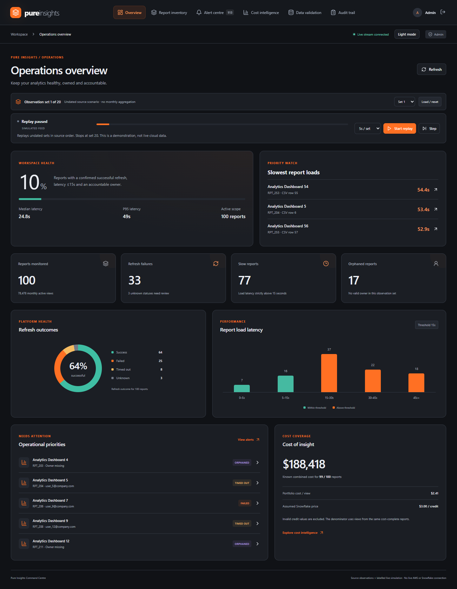
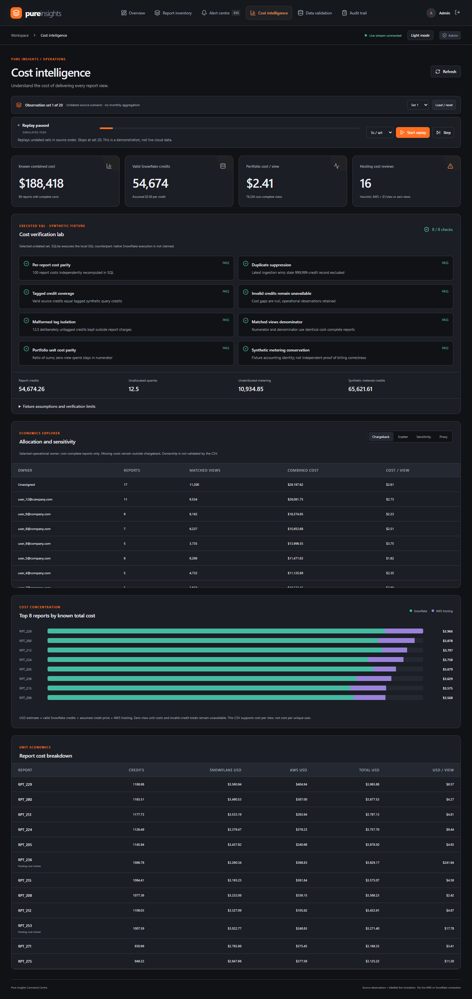
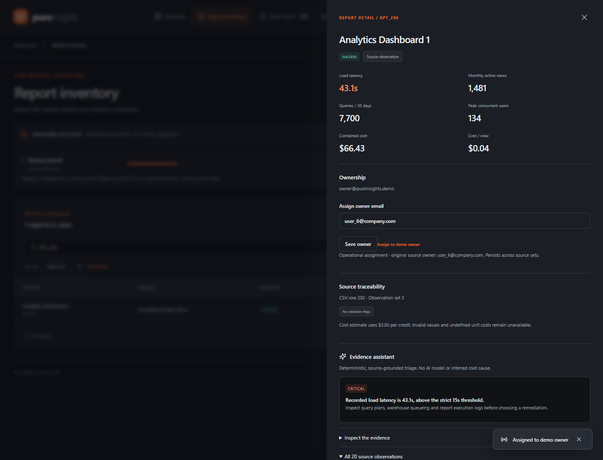
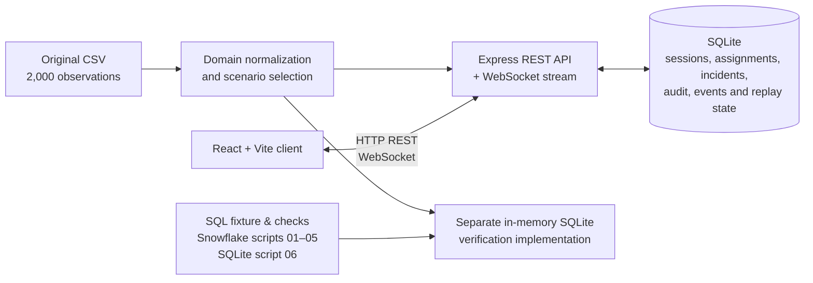

# Pure Insights Command Centre

> Everpure placement submission · Case Study 3 — Technical Data AI Validation: Monetization

Pure Insights Command Centre is a local React and Node.js workspace for investigating report health, ownership and cost attribution. It turns the supplied report observations into a controlled operational simulation: teams can inspect slow loads and refresh failures, follow incident recovery, assign operational ownership, and examine cost-per-view calculations without presenting the fixture as a live cloud bill.

The project is deliberately explicit about its evidence boundaries. Replay is a simulated feed over undated source scenarios; the evidence assistant is deterministic rather than an LLM; and the cost lab runs a separate SQLite implementation of the verification logic.

## Evaluator quick scan

| In 60 seconds | Evidence |
| --- | --- |
| Run it | `npm ci && npm run build && npm start` → [http://localhost:3000](http://localhost:3000) |
| Sign in | `admin@pureinsights.demo` / `InsightsDemo2026!` |
| Verify it | `npm test` → 33 passing Node tests; browser suite also passed locally |
| Core proof | Server-enforced RBAC/redaction, WebSocket alerts, replay controls, SQLite cost lab and Snowflake SQL suite |
| Important boundary | The source is 20 undated simulated scenarios—not live AWS/Snowflake telemetry or a provider bill |

## Contents

- [At a glance](#at-a-glance)
- [Application views](#application-views)
- [Architecture](#architecture)
- [Run locally](#run-locally)
- [Roles, security and scope](#roles-security-and-scope)
- [Replay, simulation and incident recovery](#replay-simulation-and-incident-recovery)
- [Cost attribution and verification boundaries](#cost-attribution-and-verification-boundaries)
- [Dataset interpretation and limitations](#dataset-interpretation-and-limitations)
- [Verify](#verify)
- [Suggested evaluator walkthrough](#suggested-evaluator-walkthrough)

## At a glance

| Case-study need | What is implemented |
| --- | --- |
| Operations visibility | Overview, inventory, alert centre, validation and audit views for report latency, refresh state and missing operational ownership. |
| React + Node role-based application | React 19/Vite client, Express 5 API and five server-enforced roles. Financial fields are projected out for Engineer, Viewer and Owner responses. |
| Real-time notification | Cookie-authenticated WebSocket stream with reconnect cursors, alert deduplication, acknowledgement and confirmed recovery. |
| Monetization analysis | Direct-credit attribution, assumed credit price, matched cost/view population, chargeback, sensitivity and an explicitly hypothetical query-count proxy. |
| SQL deliverables | Snowflake fixture and attribution scripts, acceptance checks, optional ACCOUNT_USAGE adapter, plus the SQLite SQL executed by the interactive lab. |
| Technical handover | API/stream contracts, architecture, data decisions, SQL guide, verification report, demo guide and automated tests. |

## Application views

### Operations overview



### Cost intelligence



### Report evidence drawer



These images were captured locally from the passing browser suite. They show seeded demonstration data, not a deployed environment or provider telemetry.

## Architecture



One Node.js 24 process serves the production client, API and authenticated stream. The original CSV stays unchanged on disk. SQLite persists local application state; it is not a cloud data warehouse. The separate verification path builds a labelled synthetic query/tag fixture and executes [`sql/06_local_verification.sql`](sql/06_local_verification.sql); the Snowflake scripts are supplied separately and are not invoked by the application.

## Run locally

### Prerequisites

- Node.js **24 LTS** (the package requires Node `>=24.0.0`)
- npm, included with Node

From the `pure-insights` directory on Windows, macOS or Linux:

```sh
npm ci
npm run build
npm start
```

Open [http://localhost:3000](http://localhost:3000). Keep the terminal open while using the app; `Ctrl+C` stops it. In PowerShell, use `npm.cmd` if execution policy blocks `npm.ps1`.

For development with Vite's proxy:

```sh
npm run dev
```

Then open [http://localhost:5173](http://localhost:5173). Stop a production server before starting development mode.

The configured local port also accepts `127.0.0.1` and IPv6 loopback. Other origins require an exact `APP_ORIGIN` configuration.

### Demo accounts

All seeded demonstration accounts use the password **`InsightsDemo2026!`**.

| Account | Role | What it can do |
| --- | --- | --- |
| `admin@pureinsights.demo` | Admin | Manage assignments/accounts, replay, simulations, costs, validation and audit. |
| `engineer@pureinsights.demo` | Engineer | Monitor operations, simulate telemetry and acknowledge alerts; financial fields are redacted. |
| `analyst@pureinsights.demo` | Analyst | Access costs and validation, and acknowledge alerts; cannot make operational changes. |
| `viewer@pureinsights.demo` | Viewer | Read operational health only; financial fields are redacted. |
| `owner@pureinsights.demo` | Owner | See only reports currently assigned to that account, along with permitted history and alerts; financial fields are redacted. |

The Owner account starts with no report assignments. As Admin, open a report and use **Assign to demo owner**, then sign in as Owner to demonstrate the server-enforced scope. Changing a role or disabling an account revokes existing sessions.

## Roles, security and scope

Authorization is enforced by the server for REST, CSV exports and WebSocket delivery—not just hidden in the UI. Sessions use an opaque HttpOnly, SameSite=Strict cookie; only a token digest is stored. Writes require the `X-App-Request: pure-insights` header and accepted same-origin requests. The API also applies input validation, body limits, rate limits, origin checks, stream revalidation and backpressure limits.

Financial values and finance-derived flags are removed from lists, report details, history, summaries, CSV and stream payloads for Engineer, Viewer and Owner roles. Owner stream events are filtered against current assignments; unrelated events do not reveal report identities.

## Replay, simulation and incident recovery

Each observation set selects the nth original occurrence for every report. The replay deck can start, pause, step one set at a time and change speed. It clears manual simulated samples as it advances, stops at set 20, and always comes up paused after a process restart. It is a **simulated feed**, not live AWS or Snowflake ingestion.

Admins can use **Load / reset** to pause replay, select a source set and clear manual samples. Engineers and Admins can publish manual latency/refresh samples. Explicit operational owner assignments persist across scenarios and restarts; the CSV source history and source owner evidence never change.

Incident policy is intentionally narrow:

- latency strictly greater than 15 seconds opens a latency condition; over 30 seconds is critical;
- `FAILED` and `TIMED_OUT` refreshes are critical;
- `UNKNOWN` is a warning data gap and cannot resolve an earlier refresh failure;
- only `SUCCESS` recovers refresh and only known latency at or below 15 seconds recovers latency;
- acknowledgement records review, not resolution; repeated failures reuse the active episode ID.

## Cost attribution and verification boundaries

The displayed cost model starts with valid direct source credits, applies the configured **$3.00/credit assumption** by default, and adds the supplied hosting component where available. Portfolio cost per view is a ratio of sums over the same cost-complete reports; it is not an average of report ratios and views are **not** unique users. Zero-view unit costs remain unavailable.

Negative credit values are analytical nulls. The report stays in operational monitoring, retaining valid latency, refresh, ownership and usage evidence, but the invalid financial value is neither replaced with zero nor made positive. The current set-1 controls are 99 cost-complete reports with 78,239 matching views, $188,417.87 known combined cost at the $3 assumption, and a portfolio cost/view of about $2.40823464.

The verification fixture keeps malformed or missing tags in an explicit unallocated bucket. It also exposes the metering residual rather than automatically charging it to reports; that residual is not proof of idle compute. The explorer's query-count allocation is a disclosed **hypothetical proxy**, never billed attribution.

The interactive lab executes SQLite SQL against its own synthetic fixture. Snowflake fixture scripts 01–04 and the optional account-usage adapter (05) were also executed natively in an isolated assessment database on October 14, 2026; see the [native run record](docs/snowflake-run.md) for exact scope, results and limits. Script 06 remains the separate SQLite counterpart.

## Dataset interpretation and limitations

- The supplied CSV has **2,000 observations**, **100 report IDs** and **20 observations per report**.
- Source order produces 20 complete observation sets. They are **undated scenarios**, not calendar months, historical measurements or non-overlapping billing periods.
- The CSV has no query IDs, warehouse identifiers, distinct-user counts or measurement dates. It cannot establish unique users, a live billing window or real cloud attribution.
- All 100 reports have conflicting non-null source owners across their source observations. An operational assignment establishes current accountability inside the demo; it does not rewrite historical source ownership.
- The evidence assistant provides deterministic, source-grounded next checks. It does not call an LLM or infer root cause.

For the complete methodology and source controls, read [Data decisions](docs/DATA_DECISIONS.md) and the [source manifest](docs/SOURCE_MANIFEST.md).

## Verify

The following commands were run locally for this README update:

```sh
npm test
npm run validate
python scripts/validate-independent.py
python -m pip install -r tests/requirements-sql.txt
python tests/sql_validation.py
npm run build
```

Results: **33/33 Node tests passed**. The independent source validator confirmed 2,000 rows, 100 reports and 20 observation sets, with golden operational/cost controls for every set. The fixture's 10 Snowflake acceptance checks passed in a native isolated run; the [native run record](docs/snowflake-run.md) documents its exact scope, data boundaries and app-parity controls. The prior [DuckDB-adaptation run](docs/DUCKDB_ADAPTATION_RUN.md) remains supplementary compatibility evidence. The Vite production build completed successfully.

Browser verification can be run with:

```sh
npx playwright install chromium
npm run test:browser
```

In this update, the browser suite passed using a locally installed Chrome executable because Playwright's managed Chromium binary was not present. It exercised all six views, login, role restrictions, search, assignment, export, alerts/recovery, replay, evidence/history, responsive layout and the delayed-refresh drawer-closure regression. The screenshots above were produced by that passing run.

To repeat the separate source and SQL checks:

```sh
python scripts/validate-independent.py
python -m pip install -r tests/requirements-sql.txt
python tests/sql_validation.py
```

The first command uses only the Python standard library. The DuckDB test validates adapted fixture semantics; it does not amount to native Snowflake execution. Docker and hosted CI configurations are included in the repository but were not exercised for this update.

## Suggested evaluator walkthrough

1. Sign in as Admin and inspect set 1: 100 reports, 33 failed/timed-out refreshes, 77 slow reports, 17 reports without an operational owner and three unknown refresh outcomes.
2. Start replay, pause it and step once. Explain that each movement is an undated scenario, not a cloud-data refresh.
3. Load set 1, inspect `RPT_203`, assign it to the demo owner, and compare the persistent operational assignment with preserved source observations.
4. Inspect `RPT_200`, recover it, then select **Slow + failed**. Acknowledge an incident and recover it to show the difference between review and confirmed recovery.
5. Open **Cost intelligence**. Review the eight SQLite verification checks, the matching denominator, direct credits, unallocated/metering residual and the labelled proxy.
6. Sign in as Owner, Viewer and Engineer to show owner scope, redaction and operational permissions. Return as Admin to inspect the audit trail and account controls.

## Project structure

```text
client/                 React/Vite interface
server/                 Express API, WebSocket stream, domain logic and SQLite store
data/reports.csv        Supplied source dataset, retained unchanged
sql/                    Snowflake fixture/attribution scripts and SQLite lab SQL
tests/                  Node, API/security and browser checks
docs/                   API contracts, architecture, data/SQL decisions and demo handover
docs/images/            Browser-captured README screenshots
scripts/                Local validation, fixture generation and development helper
```

## Configuration and troubleshooting

`npm start` does not load `.env` automatically. To apply the included template, copy `.env.example` to `.env`, edit it, then use:

```sh
node --env-file=.env server/index.js
```

| Variable | Default | Purpose |
| --- | --- | --- |
| `PORT` / `HOST` | `3000` / `127.0.0.1` | Local server address. |
| `APP_ORIGIN` | `http://localhost:3000` | Exact browser origin; same-port loopback aliases are permitted. |
| `DB_PATH` | `runtime/insights.sqlite` | Persistent local application state. |
| `DEMO_MODE` | `true` | Enables demo accounts, replay and simulated telemetry. |
| `DEMO_PASSWORD` | `InsightsDemo2026!` | Seed password on first account creation; does not reset existing accounts. |
| `CREDIT_PRICE_USD` | `3` | Non-negative cost assumption also used by the interactive lab. |
| `COOKIE_SECURE` | `false` locally | Set `true` behind HTTPS. |

First run creates `runtime/insights.sqlite`. It persists sessions, owner assignments, selected source set, simulated samples, incident episodes and audit history. For a fresh demonstration, start with a fresh runtime database; do not commit runtime databases, `node_modules`, `.env`, `client/dist` or browser-test output.

## Further documentation

- [REST and WebSocket specification](docs/API_WEBSOCKET_SPEC.md) · [OpenAPI](docs/openapi.json) · [AsyncAPI](docs/asyncapi.json)
- [Architecture](docs/ARCHITECTURE.md)
- [Data decisions](docs/DATA_DECISIONS.md) · [SQL guide](docs/SQL_GUIDE.md)
- [Verification report](docs/VERIFICATION_REPORT.md) · [Native Snowflake run](docs/snowflake-run.md) · [Executed DuckDB-adaptation run](docs/DUCKDB_ADAPTATION_RUN.md)
- [Demo and interview handover](docs/DEMO_AND_INTERVIEW.md)
- [Improvement notes](docs/IMPROVEMENTS.md)
